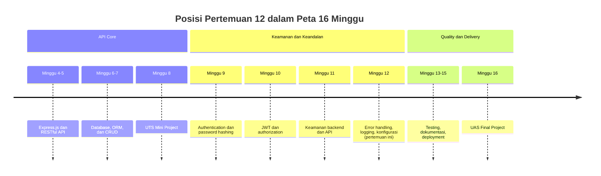
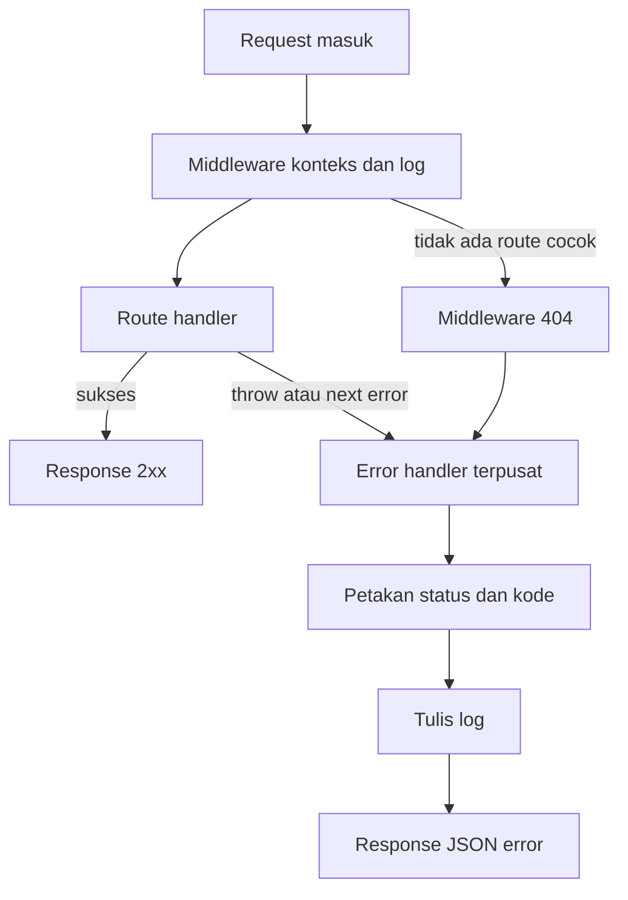
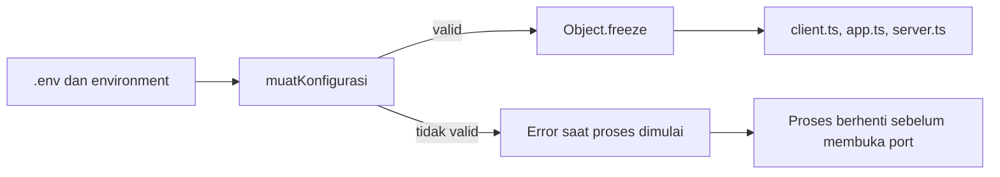
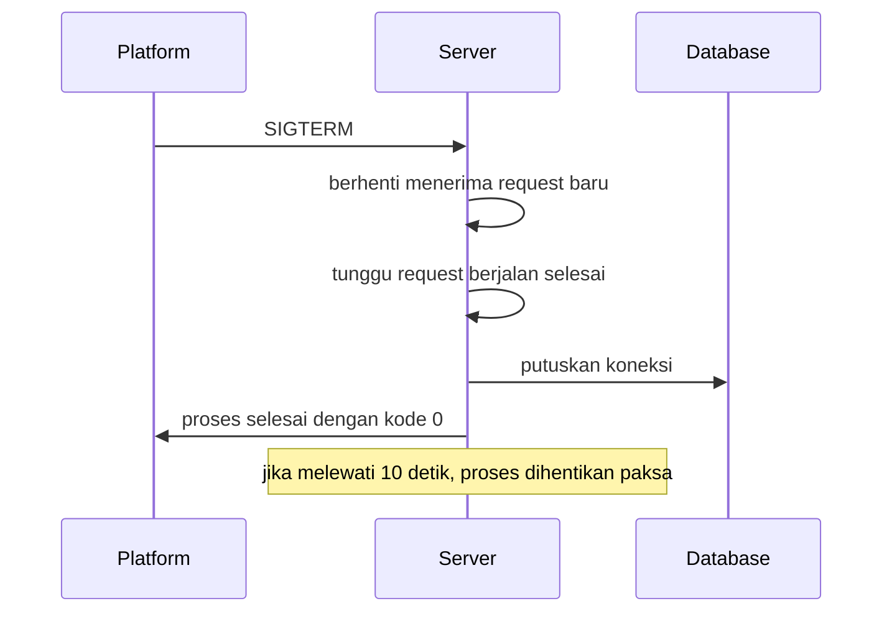

# Pertemuan 12 — Error Handling, Logging, dan Konfigurasi

| | |
|:--|:--|
| **Minggu** | 12 |
| **Tanggal** | Senin, 30 November 2026 (SI-VA) / Selasa, 1 Desember 2026 (SI-VB) |
| **CPMK** | CPMK118 |
| **Model Pembelajaran** | Case Based Learning / Problem Based Learning |
| **Stack** | Node.js 22.12+, Express.js 5, Prisma ORM 7, SQLite, TypeScript |

> **Catatan penting:** Pada Pertemuan 11, Anda mengamankan API melalui validasi masukan, security header, CORS, dan rate limiting. Pertemuan ini membahas **ketahanan operasional**: bagaimana aplikasi menangani kegagalan, mencatat kejadian, dan membaca konfigurasi secara terkendali. Fokusnya bukan menambah fitur bisnis, melainkan memastikan API tetap dapat dipahami dan dipulihkan ketika terjadi kesalahan.

---

## Daftar Isi

- [Pertemuan 12 — Error Handling, Logging, dan Konfigurasi](#pertemuan-12--error-handling-logging-dan-konfigurasi)
  - [Daftar Isi](#daftar-isi)
  - [1. Keterkaitan Pertemuan dengan RPS OBE](#1-keterkaitan-pertemuan-dengan-rps-obe)
  - [2. Capaian Pembelajaran Pertemuan](#2-capaian-pembelajaran-pertemuan)
  - [3. Pemantik Kasus: Pesan Error yang Membocorkan dan Log yang Tidak Terlacak](#3-pemantik-kasus-pesan-error-yang-membocorkan-dan-log-yang-tidak-terlacak)
  - [4. Bagaimana Error Bergerak di Express](#4-bagaimana-error-bergerak-di-express)
  - [5. Error Operasional dan Error Pemrograman](#5-error-operasional-dan-error-pemrograman)
  - [6. Kelas Error Aplikasi](#6-kelas-error-aplikasi)
  - [7. Error Handler Terpusat](#7-error-handler-terpusat)
  - [8. Logging Terstruktur](#8-logging-terstruktur)
  - [9. Korelasi Request dan Pengukuran Durasi](#9-korelasi-request-dan-pengukuran-durasi)
  - [10. Konfigurasi Environment yang Tervalidasi](#10-konfigurasi-environment-yang-tervalidasi)
  - [11. Penghentian Terkendali dan Kegagalan Tak Tertangani](#11-penghentian-terkendali-dan-kegagalan-tak-tertangani)
  - [12. Alur Demonstrasi dan Pengujian](#12-alur-demonstrasi-dan-pengujian)
  - [13. Tinjauan Keputusan Desain](#13-tinjauan-keputusan-desain)
  - [14. Kesalahan Umum](#14-kesalahan-umum)
  - [15. Batasan Implementasi](#15-batasan-implementasi)
  - [16. Aktivitas Kelompok](#16-aktivitas-kelompok)
  - [17. Latihan Individu](#17-latihan-individu)
  - [18. Pemanfaatan AI sebagai Coding Assistant](#18-pemanfaatan-ai-sebagai-coding-assistant)
  - [19. Kuis Formatif](#19-kuis-formatif)
  - [20. Output Pembelajaran — Tugas Ketahanan Operasional](#20-output-pembelajaran--tugas-ketahanan-operasional)
    - [Cara Pengumpulan — Push ke Repository GitHub Kelas](#cara-pengumpulan--push-ke-repository-github-kelas)
  - [21. Rubrik Tugas Ketahanan Operasional](#21-rubrik-tugas-ketahanan-operasional)
  - [22. Persiapan menuju Pertemuan 13](#22-persiapan-menuju-pertemuan-13)
  - [Lampiran: Kode Referensi](#lampiran-kode-referensi)

---

## 1. Keterkaitan Pertemuan dengan RPS OBE

Pertemuan 12 menutup fase **Keamanan dan Keandalan** dan mendukung CPMK118: mahasiswa mampu menerapkan authentication dan authorization, mengamankan API, serta membangun error handling dan konfigurasi terpusat. Setelah API terlindungi pada Pertemuan 11, pertemuan ini memastikan API juga **dapat dioperasikan**: kegagalan tercatat dengan benar, pesan ke client tidak membocorkan detail internal, dan konfigurasi berbeda antarlingkungan dibaca dari satu tempat.



## 2. Capaian Pembelajaran Pertemuan

| No. | Kemampuan | Indikator |
| :-: | --------- | --------- |
| 1 | Menjelaskan alur error pada Express | Membedakan error sinkron dan async serta menjelaskan peran `next(error)` |
| 2 | Membuat kelas error aplikasi | `AppError` membawa status HTTP, kode, dan detail yang aman dikirim |
| 3 | Menerapkan error handler terpusat | Seluruh kegagalan menghasilkan bentuk response yang seragam |
| 4 | Memetakan error database | Kode Prisma seperti `P2002` dan `P2025` menjadi status `409` dan `404` |
| 5 | Menulis log terstruktur | Log memuat waktu, tingkat, pesan, dan konteks dalam bentuk JSON |
| 6 | Menghubungkan log dengan request | Setiap request memiliki `X-Request-Id` dan durasi tercatat |
| 7 | Mengelola konfigurasi environment | Nilai wajib divalidasi saat proses dimulai; nilai salah menghentikan proses |
| 8 | Menerapkan penghentian terkendali | Server berhenti setelah request berjalan selesai dan koneksi database ditutup |

## 3. Pemantik Kasus: Pesan Error yang Membocorkan dan Log yang Tidak Terlacak

Sebuah API peminjaman buku menerima laporan bahwa endpoint `POST /buku` sesekali mengembalikan pesan berikut:

```
Invalid `prisma.buku.create()` invocation: Unique constraint failed on the fields: (`judul`,`penulis`)
```

Pesan tersebut memberi tahu client bahwa server memakai Prisma, menyebut nama tabel, dan mengungkap struktur unique constraint. Pada kejadian lain, server berhenti tanpa pesan apa pun, dan tim tidak dapat menentukan request mana yang menyebabkannya karena setiap log hanya berisi `Error: something went wrong` tanpa penanda waktu maupun identitas request.

Diskusikan: mengapa pesan error database tidak layak dikirim ke client? Informasi apa yang harus ada pada satu baris log agar kejadian tersebut dapat ditelusuri? Mengapa konfigurasi yang salah sebaiknya diketahui saat server dimulai, bukan saat request pertama masuk?

## 4. Bagaimana Error Bergerak di Express

Express menjalankan middleware secara berurutan. Ketika sebuah middleware atau handler melempar error, Express menghentikan rantai normal dan mencari **error handler**, yaitu middleware dengan empat parameter `(error, request, response, next)`.



Tiga jalur yang perlu dibedakan:

1. **Error sinkron** dilempar di dalam handler biasa. Express menangkapnya secara otomatis.
2. **Error async pada Express 5** berasal dari Promise yang ditolak di dalam handler `async`. Express 5 meneruskannya ke error handler tanpa perlu `try/catch` di setiap route.
3. **Error yang diteruskan manual** memakai `next(error)`, misalnya pada middleware yang tidak melempar error tetapi memilih meneruskannya.

Contoh handler async yang melempar error tanpa `try/catch`:

```typescript
export const handlerDetailBuku: RequestHandler = async (request, response) => {
  const buku = await ambilBuku(bacaId(request.params.id));
  response.status(200).json({ success: true, message: "Detail buku", data: buku });
};
```

Pada Express 5, jika `ambilBuku` melempar `AppError` atau Promise ditolak, error langsung menuju error handler. Karena itu route tidak perlu membungkus setiap handler dengan `try/catch`, dan penanganan kegagalan tetap berada di satu tempat.

## 5. Error Operasional dan Error Pemrograman

Tidak semua error layak diperlakukan sama.

| Jenis | Contoh | Perlakuan |
|:------|:-------|:----------|
| Operasional | Input tidak valid, data tidak ditemukan, bentrok unique constraint | Diterjemahkan menjadi status `4xx` dan pesan yang aman untuk client |
| Pemrograman | `TypeError` karena properti salah, bug logika, koneksi database terputus | Dicatat sebagai `500` dengan pesan umum; detail hanya pada log |

Pemisahan ini mencegah dua kesalahan sekaligus: membocorkan detail internal ke client, dan menyamakan kesalahan client dengan kegagalan server. Status `4xx` menandakan client perlu memperbaiki permintaannya; status `5xx` menandakan server perlu diperiksa.

## 6. Kelas Error Aplikasi

`AppError` membawa informasi yang dibutuhkan error handler sehingga handler tidak perlu menebak bentuk setiap kegagalan.

```typescript
export class AppError extends Error {
  readonly statusCode: number;
  readonly code: KodeError;
  readonly details?: unknown;
  readonly isOperational: boolean;

  constructor(
    pesan: string,
    statusCode: number,
    code: KodeError,
    details?: unknown,
    isOperational = true,
  ) {
    super(pesan);
    this.name = "AppError";
    this.statusCode = statusCode;
    this.code = code;
    this.details = details;
    this.isOperational = isOperational;
  }
}
```

Field `code` dipisahkan dari `message` karena kode bersifat stabil dan dapat dipakai client untuk menentukan alur penanganan, sedangkan pesan dapat berubah tanpa merusak integrasi. Fungsi pembuat berikut memusatkan status yang sering dipakai:

```typescript
export const validationError = (details: unknown, pesan = "Data tidak valid"): AppError =>
  new AppError(pesan, 400, "VALIDATION_ERROR", details);

export const notFoundError = (pesan = "Resource tidak ditemukan"): AppError =>
  new AppError(pesan, 404, "NOT_FOUND");

export const conflictError = (pesan = "Data sudah ada"): AppError =>
  new AppError(pesan, 409, "CONFLICT");
```

Dengan pola ini, service dapat melempar `notFoundError` tanpa mengetahui cara menulis response:

```typescript
export const ambilBuku = async (id: number) => {
  const buku = await prisma.buku.findUnique({ where: { id } });
  if (!buku) throw notFoundError(`Buku dengan id ${id} tidak ditemukan`);
  return buku;
};
```

## 7. Error Handler Terpusat

Error handler memetakan setiap kegagalan menjadi status, kode, dan pesan. Pemetaan dilakukan bertahap agar mudah diuji dan tidak menumpuk dalam satu fungsi.

| Sumber error | Status | Kode |
|:-------------|:------:|:-----|
| `AppError` validasi | 400 | `VALIDATION_ERROR` |
| `AppError` tidak ditemukan | 404 | `NOT_FOUND` |
| `AppError` bentrok | 409 | `CONFLICT` |
| Prisma `P2002` (unique) | 409 | `CONFLICT` |
| Prisma `P2025` (record tidak ada) | 404 | `NOT_FOUND` |
| Body JSON rusak (`entity.parse.failed`) | 400 | `VALIDATION_ERROR` |
| Body terlalu besar (`entity.too.large`) | 413 | `VALIDATION_ERROR` |
| Error lain | 500 | `INTERNAL` |

Pemetaan Prisma hanya memakai kode yang stabil:

```typescript
const dariPrisma = (error: unknown): MuatanError | undefined => {
  if (!(error instanceof Prisma.PrismaClientKnownRequestError)) return undefined;
  if (error.code === "P2002") {
    return { statusCode: 409, code: "CONFLICT", message: "Data dengan nilai unik tersebut sudah ada" };
  }
  if (error.code === "P2025") {
    return { statusCode: 404, code: "NOT_FOUND", message: "Resource tidak ditemukan" };
  }
  return undefined;
};
```

Handler akhir menulis log sesuai tingkat kepentingan dan mengirim response seragam:

```typescript
export const errorHandler: ErrorRequestHandler = (error, request, response, _next) => {
  const requestId = (request as RequestBerId).requestId ?? "-";
  const muatan = petakan(error);

  const konteks = {
    requestId,
    statusCode: muatan.statusCode,
    code: muatan.code,
    ...(error instanceof Error ? { errorName: error.name } : {}),
  };

  if (muatan.statusCode >= 500) {
    logger.error("request gagal", {
      ...konteks,
      stack: error instanceof Error ? error.stack : undefined,
    });
  } else {
    logger.warn("request ditolak", konteks);
  }

  response.status(muatan.statusCode).json({
    success: false,
    code: muatan.code,
    message: muatan.message,
    ...(muatan.details !== undefined ? { details: muatan.details } : {}),
    requestId,
  });
};
```

Status `5xx` dicatat sebagai `error` karena menandakan masalah server; status `4xx` dicatat sebagai `warn` karena berasal dari masukan client. Field `requestId` disertakan pada response agar pengguna dapat menyebutkannya ketika melapor.

## 8. Logging Terstruktur

`console.log` dengan teks bebas sulit disaring dan dihitung. Logger terstruktur menulis satu objek JSON per baris sehingga sistem pengumpul log dapat memfilter berdasarkan field.

```typescript
const tulis = (tingkat: TingkatLog, pesan: string, konteks: Konteks) => {
  if (bobot[tingkat] < bobot[konfigurasi.logLevel]) return;

  const entri = {
    waktu: new Date().toISOString(),
    tingkat,
    pesan,
    ...(redaksi(konteks) as Konteks),
  };
  const teks = `${JSON.stringify(entri)}\n`;

  if (tingkat === "warn" || tingkat === "error") {
    process.stderr.write(teks);
    return;
  }
  process.stdout.write(teks);
};
```

Tingkat log yang dipakai:

| Tingkat | Penggunaan |
|:--------|:-----------|
| `debug` | Detail pengembangan yang tidak perlu tampil di production |
| `info` | Kejadian normal: server berjalan, request selesai |
| `warn` | Penolakan yang diperkirakan: validasi gagal, resource tidak ditemukan |
| `error` | Kegagalan server: error tak terduga, koneksi database bermasalah |

Sebelum ditulis, konteks melewati fungsi redaksi yang mengganti nilai sensitif:

```typescript
const redaksi = (nilai: unknown): unknown => {
  if (nilai === null || typeof nilai !== "object") return nilai;
  if (Array.isArray(nilai)) return nilai.map(redaksi);

  const hasil: Record<string, unknown> = {};
  for (const [kunci, isi] of Object.entries(nilai as Record<string, unknown>)) {
    hasil[kunci] = KUNCI_SENSITIF.has(kunci.toLowerCase()) ? "[REDACTED]" : redaksi(isi);
  }
  return hasil;
};
```

Log `warn` dan `error` dikirim ke `stderr` agar dapat dipisahkan dari log informasi pada `stdout`. Pada layanan nyata, keduanya biasanya dialirkan ke sistem pengumpul log yang menyimpan, mencari, dan memberi peringatan otomatis.

## 9. Korelasi Request dan Pengukuran Durasi

Satu request dapat menghasilkan beberapa baris log: mulai diproses, ditolak atau selesai, dan kadang error. Tanpa penanda yang sama, baris-baris tersebut tidak dapat dihubungkan.

```typescript
export const beriRequestId: RequestHandler = (request, response, next) => {
  const id = randomUUID();
  (request as RequestBerId).requestId = id;
  response.setHeader("X-Request-Id", id);
  next();
};

export const catatAkses: RequestHandler = (request, response, next) => {
  const mulai = performance.now();

  response.on("finish", () => {
    logger.info("request selesai", {
      requestId: (request as RequestBerId).requestId ?? "-",
      method: request.method,
      path: request.originalUrl,
      status: response.statusCode,
      durasiMs: Math.round((performance.now() - mulai) * 100) / 100,
    });
  });

  next();
};
```

`X-Request-Id` dikirim pada response sehingga client dan server memakai penanda yang sama saat membahas satu kejadian. Event `finish` dipilih karena pada saat itu status code sudah pasti, sehingga durasi yang dicatat mencakup seluruh pemrosesan.

## 10. Konfigurasi Environment yang Tervalidasi

Konfigurasi yang tersebar di banyak berkas sulit diperiksa. Modul konfigurasi membaca seluruh nilai environment satu kali, memvalidasinya, lalu membekukan hasilnya.



| Variabel | Wajib | Bawaan | Aturan |
|:---------|:-----:|:-------|:-------|
| `NODE_ENV` | Tidak | `development` | `development`, `test`, atau `production` |
| `PORT` | Tidak | `3012` | Bilangan bulat positif |
| `DATABASE_URL` | Tidak | `file:./prisma/dev.db` | Tidak boleh kosong |
| `LOG_LEVEL` | Tidak | `info` | `debug`, `info`, `warn`, atau `error` |
| `CORS_ORIGIN` | Tidak | `http://localhost:5173` | Daftar origin dipisah koma |

Nilai yang salah menghentikan proses, bukan diganti diam-diam:

```typescript
const bacaAngka = (nama: string, cadangan: number): number => {
  const mentah = process.env[nama];
  const nilai = typeof mentah === "string" ? mentah.trim() : "";
  if (nilai === "") return cadangan;
  const angka = Number(nilai);
  if (!Number.isInteger(angka) || angka <= 0) {
    throw new Error(`Konfigurasi ${nama} harus bilangan bulat positif, diterima "${nilai}"`);
  }
  return angka;
};
```

Pengecekan `typeof` memastikan `Number()` hanya menerima string. Mengganti nilai yang salah dengan nilai cadangan secara diam-diam justru menyulitkan diagnosis karena aplikasi tampak berjalan dengan konfigurasi yang tidak dimaksudkan.

Hasil konfigurasi dibekukan agar tidak berubah saat runtime:

```typescript
export const konfigurasi = Object.freeze(muatKonfigurasi());
```

## 11. Penghentian Terkendali dan Kegagalan Tak Tertangani

Server produksi menerima sinyal penghentian dari platform, misalnya `SIGTERM` saat deployment ulang. Proses harus berhenti tanpa memutus request yang sedang berjalan dan tanpa meninggalkan koneksi database terbuka.



```typescript
const tutupDenganAman = (sinyal: string) => {
  logger.info("sinyal penghentian diterima", { sinyal });

  const batasWaktu = setTimeout(() => {
    logger.error("penghentian melebihi batas waktu, proses dihentikan paksa", { sinyal });
    process.exit(1);
  }, 10_000);

  batasWaktu.unref();

  server.close(() => {
    void prisma.$disconnect().finally(() => {
      clearTimeout(batasWaktu);
      logger.info("server berhenti dengan bersih", { sinyal });
      process.exit(0);
    });
  });
};
```

Selain sinyal, dua kegagalan tingkat proses perlu ditangani:

| Kejadian | Perlakuan |
|:---------|:----------|
| `unhandledRejection` | Promise ditolak tanpa `catch`; dicatat agar penyebabnya terlihat |
| `uncaughtException` | Error tidak tertangkap; dicatat, koneksi ditutup, proses dihentikan |

`uncaughtException` dihentikan karena keadaan proses setelah exception tak tertangani tidak dapat dipastikan. Membiarkan proses berjalan berisiko menghasilkan perilaku yang tidak konsisten.

## 12. Alur Demonstrasi dan Pengujian

Kode praktikum ada pada [`code/pertemuan-12/`](../code/pertemuan-12/). Contoh ini melanjutkan API buku dari Pertemuan 11 dan memusatkan pembahasan pada error handling, logging, dan konfigurasi. Dari direktori tersebut jalankan:

```bash
npm install
cp .env.example .env
npx prisma migrate dev --name init
npx prisma generate
npm start
```

Server memakai port `3012`. Uji jalur sukses dan jalur kegagalan:

```bash
curl -i http://localhost:3012/health

curl -i -X POST http://localhost:3012/api/buku \
  -H "Content-Type: application/json" \
  -d '{"judul":"Clean Code","penulis":"Robert Martin","stok":5}'

curl -i -X POST http://localhost:3012/api/buku \
  -H "Content-Type: application/json" \
  -d '{"judul":"Clean Code","penulis":"Robert Martin","stok":5}'

curl -i -X POST http://localhost:3012/api/buku \
  -H "Content-Type: application/json" \
  -d '{"judul":"","penulis":"X","stok":-1}'

curl -i "http://localhost:3012/api/buku?minStok=abc"
curl -i http://localhost:3012/api/buku/999
curl -i http://localhost:3012/tidak-ada
curl -i -X POST http://localhost:3012/api/buku \
  -H "Content-Type: application/json" \
  -d '{broken'
```

Uji penghentian terkendali dengan menekan `Ctrl+C` pada terminal server, lalu periksa log. Uji konfigurasi tidak valid dengan menjalankan proses memakai port yang salah:

```bash
PORT=abc npm start
```

Ringkasan hasil yang diharapkan:

| Skenario | Hasil |
|:---------|:------|
| `GET /health` | 200 dengan header `X-Request-Id` |
| `POST /api/buku` valid | 201 dengan data buku |
| `POST /api/buku` duplikat | 409 dengan kode `CONFLICT` |
| `POST /api/buku` body tidak valid | 400 dengan kode `VALIDATION_ERROR` dan daftar `details` |
| `GET /api/buku?minStok=abc` | 400 dengan kode `VALIDATION_ERROR` |
| `GET /api/buku/999` | 404 dengan kode `NOT_FOUND` |
| `GET /tidak-ada` | 404 dengan kode `NOT_FOUND` |
| `POST /api/buku` JSON rusak | 400 dengan pesan `Body JSON tidak valid` |
| Body lebih dari 100 KB | 413 |
| `Ctrl+C` | Log mencatat sinyal, server berhenti dengan kode 0 |
| `PORT=abc` | Proses berhenti dengan pesan `Konfigurasi PORT harus bilangan bulat positif` |

## 13. Tinjauan Keputusan Desain

- `AppError` memisahkan status, kode, dan pesan agar controller dan service tidak menulis response sendiri.
- Pemetaan error dipecah menjadi fungsi kecil sehingga penambahan jenis error baru tidak menambah kerumitan pada satu handler.
- Error Prisma dipetakan berdasarkan kode, bukan teks pesan, karena teks dapat berubah antarversi.
- `X-Request-Id` dipasang paling awal agar semua log, termasuk log penolakan, memiliki penanda yang sama.
- Logger menulis JSON per baris agar dapat disaring oleh sistem pengumpul log tanpa pengurai khusus.
- Redaksi kunci sensitif dilakukan sebelum penulisan log agar kredensial tidak tersimpan.
- Konfigurasi divalidasi saat proses dimulai agar kesalahan tidak muncul pada request pertama.
- `Object.freeze` mencegah modul lain mengubah konfigurasi saat runtime.
- Penghentian memakai batas waktu agar proses tidak menggantung selamanya ketika ada request macet.
- `uncaughtException` menghentikan proses karena keadaan setelah exception tak tertangani tidak dapat dipastikan.

## 14. Kesalahan Umum

1. Membiarkan pesan error database dikirim langsung ke client.
2. Menangani error hanya pada beberapa route sehingga kegagalan lain menjadi respons `500` tanpa bentuk yang jelas.
3. Memakai `try/catch` di setiap handler lalu mengirim response sendiri-sendiri sehingga format response tidak seragam.
4. Menulis log dengan `console.log` berisi teks bebas tanpa tingkat dan tanpa penanda request.
5. Mencatat objek request atau token ke dalam log sehingga kredensial tersimpan.
6. Membaca `process.env` di banyak berkas tanpa validasi sehingga nilai kosong lolos ke lapisan bawah.
7. Mengganti nilai konfigurasi yang salah dengan nilai cadangan secara diam-diam.
8. Tidak menutup koneksi database saat proses berhenti.
9. Membiarkan proses berjalan setelah `uncaughtException`.
10. Mengirim status `200` untuk respons yang menandai kegagalan pada body `{ success: false }`; status HTTP harus mencerminkan hasil.

## 15. Batasan Implementasi

Logger pada contoh ini menulis ke `stdout` dan `stderr` tanpa penyimpanan terpusat, rotasi berkas, atau pengiriman ke layanan pemantauan. Redaksi hanya memeriksa nama kunci, sehingga nilai sensitif yang terselip pada teks bebas tidak otomatis tersaring. Konfigurasi dibaca dari berkas `.env` dan environment proses, belum dari secret manager. Error handler memetakan dua kode Prisma yang umum; kode lain diperlakukan sebagai `500`. Penghentian terkendali mengasumsikan satu proses; pada deployment banyak instance, setiap instance menerima sinyal secara terpisah. Contoh ini belum mencakup tracing terdistribusi, metrik, atau peringatan otomatis.

## 16. Aktivitas Kelompok

Susun **peta kegagalan** untuk domain mini project kelompok. Untuk setiap endpoint, tuliskan kemungkinan kegagalan, status HTTP yang tepat, kode error yang dipakai, serta isi log yang diperlukan. Tandai kegagalan yang berasal dari client dan kegagalan yang berasal dari server. Tukarkan peta tersebut antarkelompok, lalu periksa apakah setiap status dan kode konsisten dengan kesepakatan yang tertulis pada README.

## 17. Latihan Individu

1. Tambahkan endpoint `GET /api/buku/:id` yang memakai `AppError` `NOT_FOUND` dan buktikan status yang dihasilkan.
2. Tambahkan satu kode error baru, misalnya `FORBIDDEN`, beserta fungsi pembuatnya, lalu petakan pada error handler.
3. Uji `LOG_LEVEL=warn` dan catat baris log yang hilang dibandingkan `LOG_LEVEL=debug`.
4. Catat konteks log yang memuat field `password` dan pastikan nilainya tertulis `[REDACTED]`.
5. Jelaskan mengapa `uncaughtException` sebaiknya menghentikan proses, sedangkan `unhandledRejection` tidak selalu.
6. Tuliskan satu contoh nilai environment yang salah dan tunjukkan pesan yang muncul saat proses dimulai.

## 18. Pemanfaatan AI sebagai Coding Assistant

**Gunakan AI untuk:**

- Meminta tinjauan error handler Anda dan mencari jenis kegagalan yang belum dipetakan.
- Meminta saran struktur log untuk satu endpoint, lalu sesuaikan dengan kebutuhan project.
- Menyusun skenario pengujian: body tidak valid, data duplikat, resource tidak ada, dan konfigurasi salah.

**Jangan gunakan AI untuk:**

- Mengirim isi `.env`, token, atau data pribadi ke layanan AI.
- Menyalin error handler tanpa memahami urutan pemeriksaan dan alasan setiap status.
- Menganggap keluaran AI sebagai pengganti pengujian; setiap klaim harus dibuktikan dengan request.

**Etika di kelas:**

1. Cantumkan penggunaan AI pada README atau refleksi tugas dan jelaskan saran yang diterapkan.
2. Verifikasi perilaku error handler dengan `curl` dan log, bukan dengan membaca kode saja.
3. Anda tetap bertanggung jawab atas keputusan desain pada project Anda.

## 19. Kuis Formatif

1. Mengapa Express 5 tidak memerlukan `try/catch` pada setiap handler async?
2. Apa perbedaan error operasional dan error pemrograman, serta bagaimana masing-masing diperlakukan?
3. Mengapa status HTTP harus berbeda antara validasi gagal dan kegagalan server?
4. Mengapa kode error dipisahkan dari pesan error?
5. Mengapa log sebaiknya ditulis sebagai JSON per baris?
6. Mengapa nilai konfigurasi yang salah sebaiknya menghentikan proses?
7. Apa manfaat `X-Request-Id` saat menelusuri kegagalan?
8. Mengapa koneksi database perlu ditutup saat proses dihentikan?

## 20. Output Pembelajaran — Tugas Ketahanan Operasional

Terapkan lapisan ketahanan operasional pada mini project kelompok: `AppError` dengan kode yang konsisten, error handler terpusat, pemetaan error database, logger terstruktur dengan redaksi, `X-Request-Id` dan durasi request, konfigurasi environment yang tervalidasi, serta penghentian terkendali.

### Cara Pengumpulan — Push ke Repository GitHub Kelas

| Kelas | Repository | Folder |
|:------|:-----------|:-------|
| SI-VA | `SI-VA-Backend` | `tugas/<nim>-<nama>/` |
| SI-VB | `SI-VB-Backend` | `tugas/<nim>-<nama>/` |

Langkah pengumpulan:

1. Buat branch menggunakan NIM Anda.
2. Perbarui mini project pada folder `tugas/<nim>-<nama>/`.
3. Jalankan `npm install`, `npx prisma migrate dev`, dan `npx prisma generate` sesuai README project.
4. Uji jalur sukses dan jalur kegagalan, lalu catat status, kode error, dan baris log pada README.
5. Commit dan push branch, lalu buat Pull Request.

Pastikan `node_modules/`, `.env`, dan file database `.db` tidak ikut di-*commit*:

```gitignore
node_modules/
.env
prisma/dev.db
prisma/generated/
```

> **Catatan:** File `prisma/generated/` adalah hasil `prisma generate` dan tidak perlu di-*commit*. File `prisma/migrations/` harus di-*commit* agar database dapat di-migrate ulang di komputer lain.

## 21. Rubrik Tugas Ketahanan Operasional

| Kriteria | Bobot | 4 (Sangat Baik) | 3 (Baik) | 2 (Cukup) | 1 (Perlu Bimbingan) |
|:---------|:-----:|:----------------|:---------|:----------|:--------------------|
| Kelas error dan pemetaan | 25% | `AppError` dipakai konsisten, status dan kode tepat, error Prisma dipetakan | Sebagian besar endpoint memakai `AppError` | Kelas error dibuat tetapi belum dipakai menyeluruh | Tidak ada kelas error; status tidak konsisten |
| Error handler terpusat | 20% | Seluruh kegagalan melewati satu handler, pesan internal tidak bocor | Error handler terpusat dengan sedikit pengecualian | Penanganan error tersebar di beberapa route | Setiap route mengirim response error sendiri |
| Logging terstruktur | 25% | Log JSON memuat waktu, tingkat, konteks, dan redaksi; `X-Request-Id` terhubung | Log terstruktur dengan sebagian konteks | Log memakai `console.log` tanpa tingkat | Tidak ada logging yang dapat ditelusuri |
| Konfigurasi environment | 20% | Seluruh konfigurasi divalidasi saat start; nilai salah menghentikan proses | Sebagian besar konfigurasi terpusat | Konfigurasi dibaca langsung dari `process.env` di banyak berkas | Nilai ditulis di dalam kode |
| Penghentian terkendali | 10% | `SIGINT`/`SIGTERM` ditangani, koneksi ditutup, batas waktu tersedia | Sinyal ditangani tanpa batas waktu | Hanya satu sinyal ditangani | Koneksi database tidak ditutup |

**Nilai akhir = Σ(bobot × skor) / 4 × 100**, dengan bobot berupa proporsi, misalnya 25% ditulis sebagai 0,25.

## 22. Persiapan menuju Pertemuan 13

Pertemuan berikutnya membahas **testing REST API**: unit test, integration test, kasus positif dan negatif, serta pengujian endpoint secara otomatis. Tinjau kembali daftar kegagalan yang Anda susun hari ini; daftar tersebut akan menjadi bahan kasus uji. Bawa mini project yang sudah memiliki error handler, logger, dan konfigurasi terpusat agar pengujian dapat memeriksa status serta bentuk response.

## Lampiran: Kode Referensi

Kode lengkap tersedia pada [`code/pertemuan-12/`](../code/pertemuan-12/).

| File | Tujuan |
|:-----|:-------|
| `src/config/env.ts` | Membaca, memvalidasi, dan membekukan konfigurasi environment |
| `src/logger/logger.ts` | Logger JSON dengan tingkat, redaksi, dan aliran `stdout`/`stderr` |
| `src/errors/app-error.ts` | `AppError` serta fungsi pembuat `validationError`, `notFoundError`, `conflictError` |
| `src/errors/error-handler.ts` | Pemetaan `AppError`, error body parser, dan error Prisma menjadi response |
| `src/middleware/request-context.middleware.ts` | `X-Request-Id` dan log akses beserta durasi |
| `src/middleware/security.middleware.ts` | Security header dan CORS selektif |
| `src/middleware/not-found.middleware.ts` | Mengubah 404 menjadi `AppError` |
| `src/controller/buku.controller.ts` | Validasi masukan dan pemanggilan service |
| `src/service/buku.service.ts` | Operasi Prisma dan pelemparan `AppError` |
| `src/routes/buku.routes.ts` | Pemetaan endpoint buku |
| `prisma/schema.prisma` | Model buku dengan unique constraint untuk pengujian `P2002` |
| `app.ts` / `server.ts` | Urutan middleware, penghentian terkendali, dan penanganan kegagalan proses |
