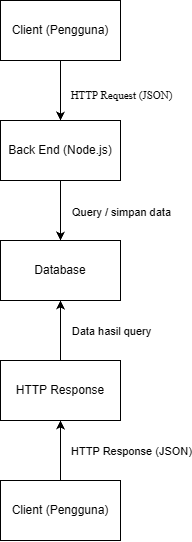

# Tugas 1 – Analisis dan Desain API

**Nama:** Disti Setiawati  
**NIM:** 240160221009  

## 1. Deskripsi Sistem

Sistem Informasi Absensi Organisasi digunakan untuk membantu pengurus mencatat dan mengelola kehadiran anggota dalam kegiatan organisasi. Pengguna sistem terdiri dari pengurus dan anggota. Pengurus dapat mengelola data anggota dan data absensi, sedangkan data absensi digunakan untuk melihat kehadiran anggota pada setiap kegiatan.

## 2. Resource dan Endpoint

### Resource: Anggota

| No | Operasi | Method | Endpoint | Request Body | Response | Status |
|---|---|---|---|---|---|---|
| 1 | Menampilkan semua anggota | GET | `/anggota` | - | Data semua anggota | 200 / 500 |
| 2 | Menampilkan anggota berdasarkan ID | GET | `/anggota/1` | - | Data anggota | 200 / 404 |
| 3 | Menambahkan anggota | POST | `/anggota` | `nama, npm, jabatan` | Data anggota yang ditambahkan | 201 / 400 |
| 4 | Mengubah data anggota | PUT | `/anggota/1` | `nama, npm, jabatan` | Data anggota yang diubah | 200 / 404 |

### Resource: Absensi

| No | Operasi | Method | Endpoint | Request Body | Response | Status |
|---|---|---|---|---|---|---|
| 5 | Menampilkan semua absensi | GET | `/absensi` | - | Data absensi | 200 / 500 |
| 6 | Menampilkan absensi berdasarkan ID | GET | `/absensi/1` | - | Data absensi | 200 / 404 |
| 7 | Menambahkan data absensi | POST | `/absensi` | `anggota_id, tanggal, status` | Data absensi yang ditambahkan | 201 / 400 |
| 8 | Menghapus data absensi | DELETE | `/absensi/1` | - | Pesan berhasil dihapus | 200 / 404 |

## 3. Contoh JSON

### 3.1 Resource Anggota

**Request Body**

```json
{
  "nama": "Disti Setiawati",
  "npm": "240160221009",
  "jabatan": "Anggota"
}
```

**Response Body**

```json
{
  "success": true,
  "data": {
    "id": 1,
    "nama": "Disti Setiawati",
    "npm": "240160221009",
    "jabatan": "Anggota"
  }
}
```

### 3.2 Resource Absensi

**Request Body**

```json
{
  "anggota_id": 1,
  "tanggal": "2026-10-06",
  "status": "hadir"
}
```

**Response Body**

```json
{
  "success": true,
  "data": {
    "id": 1,
    "anggota_id": 1,
    "tanggal": "2026-10-06",
    "status": "hadir"
  }
}
```

## 4. Skenario Request–Response

### Skenario 1 – Menampilkan Data Anggota

**Request**
- Method: GET
- Endpoint: `/anggota`
- Request Body: Tidak ada

**Response**
- Status: 200 OK

```json
{
  "success": true,
  "data": [
    {
      "id": 1,
      "nama": "Disti Setiawati",
      "npm": "240160221009",
      "jabatan": "Anggota"
    }
  ]
}
```

### Skenario 2 – Menambahkan Data Absensi

**Request**
- Method: POST
- Endpoint: `/absensi`

Request Body:

```json
{
  "anggota_id": 1,
  "tanggal": "2026-10-06",
  "status": "hadir"
}
```

**Response**
- Status: 201 Created

```json
{
  "success": true,
  "message": "Data absensi berhasil ditambahkan",
  "data": {
    "id": 1,
    "anggota_id": 1,
    "tanggal": "2026-10-06",
    "status": "hadir"
  }
}
```

### Skenario 3 – Data Anggota Tidak Ditemukan

**Request**
- Method: GET
- Endpoint: `/anggota/99`
- Request Body: Tidak ada

**Response**
- Status: 404 Not Found

```json
{
  "success": false,
  "message": "Data anggota tidak ditemukan"
}
```

## 5. Diagram Arsitektur

Berikut merupakan gambaran arsitektur Sistem Informasi Absensi Organisasi.

